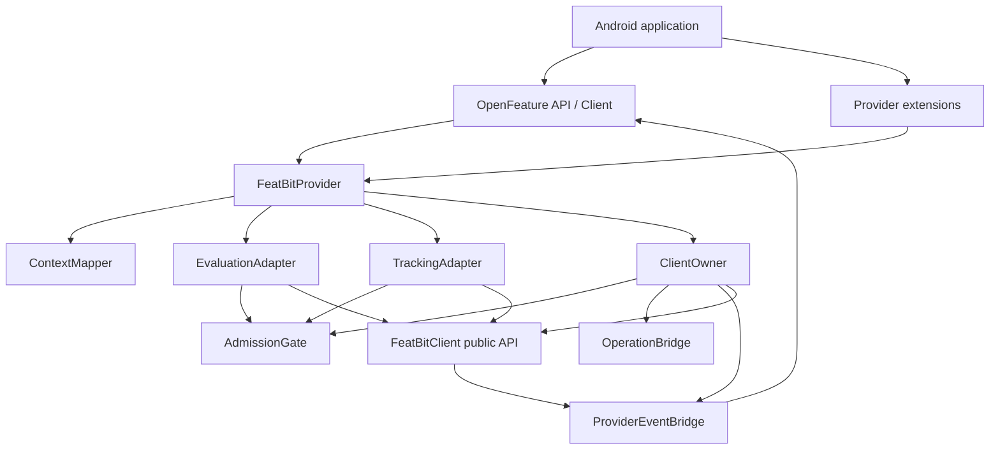
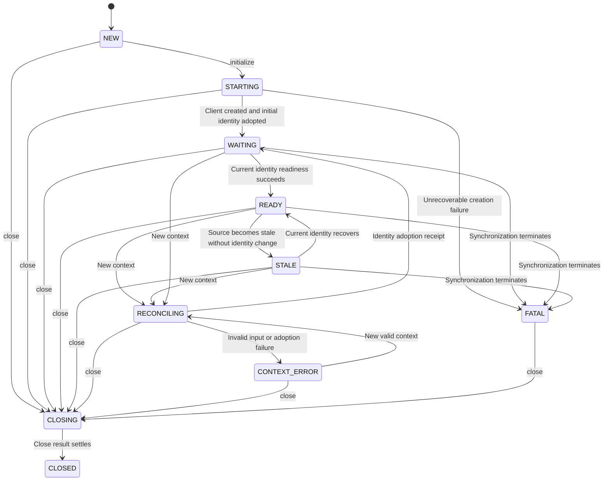
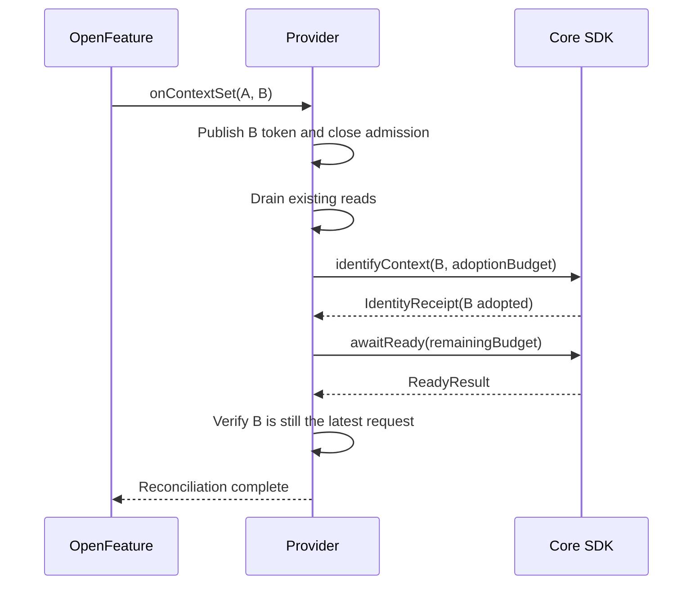

# Detailed Architecture Design

Design date: 2026-10-05; baseline update: 2026-10-06; design additions: 2026-10-09. Status: a provider development implementation exists; see the [verification record](./verification.md) for coverage. This document and the [core SDK contract](./core-sdk-contract.md) define integration goals. The [API design](./api-design.md) defines public boundaries; the [behavior specification](./behavior-design.md) defines mappings. Core SDK 0.2.0 is released and satisfies G01. OpenFeature 0.9.0 status arbitration still does not satisfy G02. Some provider verification is complete, but not all release gates have passed.

## 1. Architecture decisions

| ID | Decision | Rationale |
| --- | --- | --- |
| D01 | One Android AAR, independent repository and version | Keep core independent of OpenFeature; do not expand into multiplatform support |
| D02 | Provider exclusively owns one core client and exposes no getClient | One identity writer prevents context mismatches |
| D03 | Configure through a User → ClientOptions factory | Use the valid identity at factory submission; reconcile later changes after creation |
| D04 | Core owns declared-type checks, Double parsing, and evaluation events | Type decisions and events must use the same flag snapshot |
| D05 | Settle identity adoption separately from readiness | Timeout does not prove identity stayed unchanged; anonymous transitions especially need receipts |
| D06 | Short state lock, serialized control coroutine, synchronous read leases | Synchronous evaluation does not wait for networking; identity changes cannot interleave with evaluation/Track |
| D07 | Separate lifecycle state from data availability | Stale is readable; Reconciling, invalid context, and Fatal are not |
| D08 | Events convey latest state and invalidation, not an audit log | Slow subscribers may merge changes without losing final state/invalidation |
| D09 | Use concrete OpenFeature exceptions | Enable v0.9.0 error hooks and fallback handling |
| D10 | Synchronous shutdown closes admission; close exposes asynchronous completion | Avoid blocking the main thread while retaining cleanup and loss counts |

Do not add networking, caching, user persistence, retry, or event-delivery implementations. Existing core TestData, background policy, and privacy handling remain the sole implementations.

## 2. Components and dependencies

| Component | Input/output contract | Owned resources |
| --- | --- | --- |
| FeatBitProvider | Forward FeatureProvider/extension methods without duplicate state | Immutable configuration and the components below |
| ContextMapper | EvaluationContext snapshot → CanonicalContext or safe ContextFailure | Pure conversion, no runtime resources |
| ClientOwner | Initialize/ChangeContext/ChangeMode/Close commands; complete lifecycle waiters and extension Operations | Single client, control scope, SDK registrations, create/adoption/readiness observation handles |
| AdmissionGate | Check call context and RuntimeSnapshot; return ReadLease or error | JVM monitor, activeReaders, immutable snapshot reference |
| EvaluationAdapter | ReadLease + flag key + requestedType → ProviderEvaluation or OpenFeatureError | No cache; core parses values |
| TrackingAdapter | ReadLease + name/details → SDK TrackResult or safe diagnostic | Once-per-provider ignored-structure diagnostic marker |
| OperationBridge | SDK Operation → retained result + coroutine wait/external Operation | Single-completion slot and Registration; observation cancellation need not cancel SDK work |
| ProviderEventBridge | Latest LifecycleSnapshot and FlagChange → per-subscriber event stream | State slot, change revision, subscriber slots; no client ownership |
| ProviderDiagnostics | Fixed code and optional OutcomeCode → configured core Logger | Default Android logger; never log keys, contexts, or credentials |

Internal interfaces are not application injection points. Tests replace only the internal CoreFacade, clock, and dispatcher; do not expose clientFactory/dispatcher arguments.

## 3. Internal data model

| Model | Fields/invariants |
| --- | --- |
| CanonicalContext | Named(key, name, immutable attributes) or Anonymous; compare full content rather than treating a hash as identity proof |
| RequestToken | New object at each entry; reference equality identifies requests without assuming a Long counter cannot overflow |
| RuntimeSnapshot | phase, desiredToken/context/error, creationContext, adoptedContext, identityReceipt, readiness, connection, modeRevision, closing; freeze creationContext at factory submission and publish remaining state atomically |
| Readiness | Unconfirmed / Remote / Local / Stale; interpret with phase/context token, not SyncStatus alone |
| ReadLease | Client reference, adoptedContext, requestToken, release-once marker; never exposed to applications |
| PendingContext | Only the latest request, mapped snapshot, and waiters; cancel superseded requests without retaining the full user history |
| LifecycleSnapshot | revision, Ready/Stale/Error/no public state, errorCode, safe message; no user information |
| ChangeAccumulator | Exact key set or All; All absorbs subsequent keys until consumed |

Invoke ContextMapper once at entry, copy attributes, and never reread a mutable EvaluationContext later. Caller mutation of a custom Context during mapping is unsupported; convert exceptions to InvalidContextError without starting the SDK. Synchronous evaluation also snapshots and canonicalizes its supplied context.

Under anonymous policy, initial null and ImmutableContext with empty key/attributes are equivalent. getTargetingKey() returns a non-null String, defaulting to `""`; omission and an explicitly empty string cannot distinguish user intentions.

## 4. State machine

The diagram shows primary paths; terminal errors can move any live state to FATAL. FATAL does not automatically recreate the client; re-registration requires a new provider. CLOSED is terminal for admission and the observable close result, but late cleanup may continue if that result reports incomplete cleanup.

| phase | Synchronous evaluation | Track | Allowed control operations |
| --- | --- | --- | --- |
| NEW/STARTING | PROVIDER_NOT_READY | Diagnose and drop | initialize, close; onContextSet may retain the latest request during STARTING |
| WAITING | PROVIDER_NOT_READY | Diagnose and drop | context, offline/online, flush, clearCache, close |
| RECONCILING | NOT_READY for the desired context; INVALID_CONTEXT for others | Drop | New context may replace the request; mode follows current adoption; flush, close |
| CONTEXT_ERROR | Stored context error takes precedence; never read the old identity | Drop | New context, flush, close; reject clearCache to avoid affecting the old user |
| READY/STALE | Current context is readable; mismatches produce INVALID_CONTEXT | Current context may Track; core controls delivery | All extensions |
| FATAL/CLOSING/CLOSED | PROVIDER_FATAL | Drop | FATAL permits flush/close; CLOSING/CLOSED permit queries/idempotent close only |

A WAITING timeout remains WAITING with a failure diagnostic, not FATAL. Explicit offline uses Local readiness and may be READY with no flags; individual keys then return FLAG_NOT_FOUND. Online cache is readable only after this identity was confirmed and became STALE; cold-start cache cannot open admission early.

## 5. Scheduling, locking, and linearization

Control runs as a logical single consumer on Dispatchers.Default without a dedicated resident thread. Expensive factory and SDK create preparation run in independent worker tasks and return results to the controller. The SDK owns disk/network threads. Use elapsedRealtime and saturating deadline addition to Long.MAX_VALUE, never wall-clock time for timeouts.

The monitor only swaps snapshots, counts leases, and updates command slots. Never call the SDK, application factory/logger, suspend, parse JSON, emit, or await an Operation while holding it. SDK callbacks update completion slots/latest signals and wake the controller, without inline state transitions.

**Synchronous evaluation lease protocol:**

1. Map the call context outside the lock. Enter the gate and verify phase, desired/adopted identity, and read permission.
2. Increment activeReaders, capture the lease, and leave immediately. Strict evaluation or Track executes outside the lock.
3. New context entry publishes its token/barrier first, blocking new leases while existing ones finish. Submit SDK identity/mode changes only after activeReaders reaches zero.
4. Recheck the lease token before returning. If another request arrived, return NOT_READY/INVALID_CONTEXT without exposing the old result. Release exactly once in finally; the last reader wakes the controller.
5. A lease admitted before the transition request may record an old-user event if its core submission succeeds. This event legally precedes the SDK identity change; it cannot be deleted retroactively because the caller later gets a fallback. **Type/parse failures may record the selected variation, but events must never be attributed to the wrong user.** Concurrent cancellation cannot undo prior events.

This avoids parsing large JSON under the provider lock or extending core Track. Calling threads hold leases; there is no unbounded evaluation queue. New evaluations cannot starve an identity request after admission closes. Existing large inputs may prolong draining and count against the lifecycle deadline.

| Action | Linearization point |
| --- | --- |
| New context replaces old request | Gate publishes desiredToken and closes new leases |
| Actual SDK user change | Core gate performs adopt and settles IdentityReceipt |
| Evaluation value/exposure attribution | Core gate confirms the snapshot and admits the event |
| Track user attribution | Core events.track gate; provider identify cannot interleave around submission |
| Close admission | Provider gate marks closing; this is not cleanup completion |
| Close completion | Retained close Operation first settles |

close is special: immediately close admission and allow direct core close notification without draining parsing leases. After core closure, new events cannot be admitted; the provider's return-time check rejects late success. Background network updates need no provider leases because core snapshot arbitration handles their races.

## 6. Initialization protocol

1. NEW → STARTING. Concurrent duplicate initialize calls join the same initialization task without repeating factory/create. Re-registering an already-created provider only reconciles the supplied context; terminal instances are not recreated.
2. Before the factory is called, select the latest valid context. Once submitted, freeze creationContext and invoke the factory once for it. PERSISTENT_ANONYMOUS always requires anonymousEnabled=true, even with a named initial user, to support logout.
3. Validate options against frozen creationContext. Check close before create submission, but do not repeat the factory for newer contexts. Preserve this creation flow whether a context arrives during the factory, after its return but before create, or after create submission. Once the client arrives, reconcile the latest valid, unexpired context before admitting reads. Closing prohibits an unsubmitted create.
4. Immediately register a successfully created client as owned. Install one status and one changes registration. If either fails, detach successful registrations, close the client, fail initialization with GENERAL, and enter FATAL.
5. Successful create proves initial adoption. Retain frozen creationContext rather than current desiredContext. Read getConnectionInformation, then awaitReady. Core continues network recovery.
6. After the latest context is adopted and ready, verify its token, set internal READY, and complete relevant lifecycle waiters. ClientOwner retains creation results even when the creation token is obsolete and must still register/reconcile the client. Old-identity readiness cannot unlock a newer identity.

For A→B during initialization, if the factory already started for A, create A once, then identifyContext(B). Core may initially start A's synchronization and user events. Provider evaluation/Track remain blocked until B is adopted and ready. This is an accepted first-release boundary, not a promise to eliminate all network activity for the frozen identity. If latest B is invalid or expires before adoption submission, retain its failure and do not admit reads as A; a later valid request may recover.

Initialization timeout starts at entry and includes factory, create, read draining, and readiness. Caller timeout does not destroy accepted initialization. The owner retains create results and may complete and emit Ready unless closed. Cancellation removes only that waiter; propagate lifecycle CancellationException unchanged.

A throwing factory, invalid options, or failed create consumes one attempt; do not automatically reinvoke the factory. Invalid initial context before the factory remains recoverable CONTEXT_ERROR, allowing a later valid context to start the unused factory. Failure after consuming factory/create is FATAL and requires a new instance.

## 7. Context transition protocol

oldContext is only a debugging hint, not internal truth. If the canonical new context equals the adopted READY/STALE identity, do not identify again. READY may complete immediately. For STALE, use current core readiness/status without forcing Stale to Ready. The same identity in WAITING only waits again; failed adoption that never took effect must be resubmitted.

Allocate RequestToken ordering at entry, then map outside the lock. If mapping finishes after its token becomes obsolete, do not overwrite a newer desired context. Even invalid input must first close old-identity admission. Reject excess lifecycle waiters before acceptance without changing the current token.

If C arrives during B's asynchronous anonymous preparation, close admission and replace the pending request. The controller may submit C so the core sequence supersedes B without waiting for B's remote readiness. Ignore B callbacks by token; core guarantees superseded preparation cannot adopt. If C is invalid, submit no C command. B may still adopt internally, but the provider remains in CONTEXT_ERROR and rejects evaluation; B becoming READY cannot clear C's error.

Owner adoption observation is independent of the caller's waiter. After caller timeout, the owner still receives completed receipts; only a receipt establishes the target as adopted. If anonymous preparation ends with TIMED_OUT/STORAGE_FAILED, never use the old identity's awaitReady as success. Retain CONTEXT_ERROR; explicitly resubmitting the same context may retry.

Ordinary context deadlines start at entry. If adoption is unsubmitted at expiry, never submit it later; keep the target failed until explicit retry. Submitted adoption receives the remaining budget; core guarantees only its internal adoption deadline. Timeout after adoption does not cancel synchronization. Initialization ownership outlives its caller: late create may complete the initial identity, but cannot unlock a newer failed/expired context.

Ordering follows provider-entry acceptance. Applications should serialize setEvaluationContextAndWait or use upstream setEvaluationContext to replace earlier requests. Concurrent AndWait calls are not guaranteed to complete in business wall-clock order. Even if upstream's stored context disagrees with its last callback, provider admission rejects wrong-identity evaluation.

## 8. Readiness monitoring and mode changes

The controller retains at most one current awaitReady observation. Token/modeRevision invalidate obsolete callbacks. Status payloads are wake-up hints only: reread getConnectionInformation when processing them; never complete reconciliation directly from queued READY.

After readiness times out for an adopted identity, retain the status subscription. On a current READY/recovery/mode hint, perform one bounded awaitReady confirmation using contextChangeTimeoutMillis. Its result can recover the provider even without another callback. Allow one confirmation per status-change cycle; after timeout, wait for another hint or explicit same-context retry rather than an endless periodic retry loop.

After confirmation, reread the connection snapshot. TERMINAL/CLOSED take precedence. Online STALE for a previously confirmed identity must produce STALE and a Stale event; REMOTE_CONFIRMED alone must not relabel it READY. Explicit offline OFFLINE_LOCAL and local-source CUSTOM_LOCAL follow local policy. Online STALE without prior confirmation for this identity remains WAITING. An identical adopted STALE context may finish reconciliation normally while retaining Stale events/status, subject to upstream arbitration below.

For setOffline/setOnline, validate timeout and call state first. On acceptance, close new leases, drain reads, and submit serially with identity commands in controller order. Use separate mode command identity and modeRevision; mode does not change CanonicalContext. Settle command results separately from read recovery:

- SUCCESS, INVALID, TIMED_OUT, CAPACITY_EXCEEDED, and other results do not establish actual mode. After completion, the owner reads isOffline/getConnectionInformation outside the lock and updates state only if identity token/modeRevision remain current. A newer command owns recovery if present.
- Failure with unchanged mode: reconfirm current-identity readiness and restore READY/STALE or retain WAITING. If offline startup lacks online endpoints and setOnline fails, preserve local readability rather than permanently blocking reads.
- Timeout after the mode actually becomes offline: recover the current valid identity under OFFLINE_LOCAL while retaining the original TIMED_OUT. Do not roll back or retry automatically. Core may have adopted offline mode but timed out stopping the old connection.
- A real offline-to-online transition clears prior core confirmation; enter WAITING for new confirmation. Repeated setOnline is not a new transition and must not proactively clear valid readiness.
- Actual offline mode can obtain OFFLINE_LOCAL, but TERMINAL/CLOSED, CONTEXT_ERROR, closing, and newer-context barriers take precedence. If still unconfirmed, continue recovery through the subscription protocol above.

ModeResult describes that command's outcome. It does not guarantee that no later mode command has occurred or that remote data is ready. Extension failure does not directly make the whole provider Error/Fatal; publish those events only when actual lifecycle state warrants them.

Submit clearCache(CURRENT_CONTEXT) only for a stably adopted identity, after accepted identity changes. Reject during RECONCILING/CONTEXT_ERROR as INVALID + provider_context_unavailable rather than silently clearing the previous user's cache. Apply the same rule to NAMESPACE for a simple contract. flush covers core-accepted events, is allowed during WAITING/RECONCILING, and does not change identity.

### Extension-operation queueing and timeouts

setOffline, setOnline, and clearCache timeoutMillis budgets start at provider acceptance and include queueing, lease draining, submission, and result waiting. Validate positivity before installing a barrier; use elapsedRealtime and saturating deadlines. Before submission, recheck closing, applicable identity/mode conditions, and remaining time. Pass only remaining milliseconds to core.

- Expiry before submission: settle TIMED_OUT, remove the command, and never submit it later. Remove its read barrier according to current token/actual state without affecting newer requests.
- Expiry after submission: inspect the core's retained result, then use single-settlement arbitration to return that result or TIMED_OUT. Never rewrite the external result afterwards. Keep owner observation to receive late results and restore state.
- External timeout or observation cancellation does not undo core work. Mode may already have changed; submitted cache clearing may still complete. Never describe timeout as side-effect-free or automatically retry side-effecting operations.
- Mode recovery has its own readiness budget and does not extend the original operation's budget. Keep admission closed until readability is confirmed.

At cache-clear submission, reconfirm stable identity and target the current core identity. Reject if it became unstable while queued. flush has no public timeout: use ClientOptions.requestTimeoutMillis from acceptance, including queueing, for its external wait. Core delivery keeps its own budget after submission; external timeout neither cancels delivery nor claims coverage of subsequently accepted events. close bypasses the ordinary queue, starts its budget at entry, and follows section 11.

## 9. Event bridge and capacity

Use subscribeChanges/subscribeStatus directly instead of core ClientAdapters.changes, whose Flow converts global changes into full invalidation and loses precise keys.

Use a shared producer and **one mergeable slot per subscriber**, not a replay=1 SharedFlow mixing all events. Each slot retains latest LifecycleSnapshot, ChangeAccumulator, and a conflated wake-up signal, so configuration events cannot evict the only Ready/Stale/Error.

| Resource | Decision |
| --- | --- |
| SDK registrations | Exactly 2 per provider, independent of observe subscribers |
| Active observe subscribers | No fixed limit; applications and OpenFeature internal listeners use the same interface, so earlier application subscriptions cannot exclude internal listeners |
| Exact changed keys per slot | Maximum 1,024, then promote to All; a notification-buffer bound, not an actual flag-count limit |
| Lifecycle state | Latest entry per slot; transient states may merge, with no event-by-event audit guarantee |
| Control commands | One latest-context slot and one status-signal slot; at most 64 pending extension operations, otherwise CAPACITY_EXCEEDED |
| Lifecycle waiters | Maximum 64 per provider; extras fail with GENERAL/capacity without replacing the current valid request |
| Failed SDK Operation observation | Check getResult; retain pending operations and combine them into one 50ms probe task. Successful observe paths do not poll |

Per-subscriber state/change slots are bounded, but total memory scales with active subscribers; there is no fixed global bound. Cancellation or normal collect completion releases the slot in finally. Closing completes all slots. Slow subscribers neither block others nor install additional core listeners.

SDK callbacks briefly lock the bridge to merge slots, then wake processing without invoking subscribers. Collectors take state/invalidation snapshots and emit outside the lock. Changes during suspension remain in the slot; compare state revision on the next pass. New collectors register and snapshot under one lock, receiving current public state then All invalidation if a source exists, so late subscribers reread data.

Publish ProviderReady on ordinary initialization/reconciliation success too. In v0.9.0, lifecycle success updates statusFlow but does not automatically put Ready into the provider stream consumed by observe. If final state is STALE, publish/retain Stale instead. Status and event updates may describe the same success; deduplicate by token/revision to avoid duplicate provider Ready events. This corrects the original assumption that upstream emits all Ready events.

At context-transition start, invalidate old lifecycle replay, clear exact keys, and accumulate All. Defer changes until READY, then deliver state before invalidation. CONTEXT_ERROR/FATAL emit safe Error events; ordinary readiness timeout emits PROVIDER_NOT_READY. Closing completes slots and discards unsent configuration changes. Collector cancellation releases only its slot, not the provider.

## 10. OpenFeature v0.9.0 status handoff limitations

The 2026-10-06 review found release 0.9.0 and main `8d727fbead4b8d8bc66dc271ad35de1ece603a8b` had identical OpenFeatureAPIInstance runtime behavior. setProviderInternal unconditionally writes Ready after initialize returns, potentially overwriting Stale/Error emitted during initialization. Deterministic tests confirm this race; see the [verification record](./verification.md). There is no callback indicating that the SDK committed initialization status. yield, fixed delays, or rereading provider state cannot prove this window is avoided.

Separate two guarantees: this protocol protects provider admission, identity, values, and event bridging; **OpenFeature.getStatus consistency also requires an upstream initialization-commit fix**. Do not poll global OpenFeatureAPI or reflectively mutate private state. Isolated API instances must work too.

Recommended upstream contract: capture provider reference/binding generation and providerStatusGeneration when initialization is registered. On success/failure, check under the same arbitration lock that the binding remains valid and no newer provider event arrived. Never overwrite newer event status. Apply this to replacement, initialization cancellation, and obsolete initialization failures. G02 must pass. Unfixed 0.9.0 is a reproduction baseline, not a complete status guarantee. Pin the final minimum version after verifying an artifact containing the fix.

Context reconciliation follows the same principle: capture event revision/request sequence **before** onContextSet, and avoid overwriting newer provider status or a later request on completion. Current source captures event generation only at completion, which cannot protect a method that emits Stale before returning normally. Commit default Ready only if no newer event exists. Retained Stale/Fatal or newer-request status takes precedence. Synchronous shortcuts and instance replacement must also validate the binding.

## 11. Operations, errors, and cleanup

OperationBridge calls getResult, then observe, then getResult again, using single-completion arbitration to close registration races. Detach owner registration on completion, or after closing work and transferring cleanup ownership. Cancelling caller await removes its wait, not the owner's result-receiving responsibility. Isolate and diagnose callback exceptions.

Provider Operations retain the core result/observe semantics: asynchronous, detachable, exactly-once callbacks, without Future or another public error type. Cancelling observation does not cancel accepted mode/flush/cache/close. Unsubmitted commands remain subject to section 8 deadlines and cannot be submitted after expiry.

| Outcome | Lifecycle handling |
| --- | --- |
| SUCCESS | Also require current token/mode/state validation |
| INVALID | User mapping errors become INVALID_CONTEXT; configuration/call-contract errors become GENERAL |
| SUPERSEDED | Propagate CancellationException for replaced requests without obsolete ProviderError |
| TIMED_OUT | Not-ready wait failure; distinguish failed adoption from timeout after adoption |
| TERMINAL_FAILURE/CLOSED | Live instance becomes FATAL; self-initiated closure emits no extra error |
| DEFERRED | Reevaluate after mode changes; retain waiting during background/pause instead of fabricating success |
| DISABLED/STORAGE_FAILED/CAPACITY_EXCEEDED/CLEANUP_FAILED | Safe GENERAL; phase determines explicit retry eligibility. Extensions retain the original Outcome |

On close, shut admission, fail unsubmitted ordinary commands with CLOSED, detach waiters, remove both SDK subscriptions, and complete observe. Close the owned client exactly once. Preserve owner cleanup paths for late create/adoption results.

The external close budget uses ClientOptions.closeTimeoutMillis when available, otherwise 5,000ms while the factory is unfinished. It determines result settlement, not whether a third-party factory can be killed. With no creation task, succeed with undeliveredEvents=0. If creation remains unresolved at the deadline, return TIMED_OUT + provider_cleanup_pending without inventing CloseResult. Propagate an existing client's core CloseResult unchanged. Immediately close late-created clients without rewriting settled results.

Release the control scope only after all owner work finishes. A noncooperative factory may retain background cleanup responsibility and must produce an explicit incomplete-cleanup report. Never erase user cache or anonymous identity files as a close side effect.

## 12. Packaging and observability

Use one provider module rooted at co.featbit.openfeature.android, with proposed internal directories for context, runtime, evaluation, events, and diagnostics. Keep fixtures in test sources and separate Kotlin/Java consumer root projects. Publish only release AAR, sources, API documentation, and Maven metadata.

Core Outcome/Operation and OpenFeature types appear in public APIs, so both dependencies use api. Baseline: Kotlin 2.2.10, JVM 11, minSdk 21. Independently verify the minimum Kotlin consumer version; do not inherit core Kotlin 1.9 compatibility. Pin a buildable AGP/Gradle/JDK combination during implementation without automatically upgrading the adjacent core project.

Use fixed diagnostic codes such as provider_context_unavailable, provider_options_user_mismatch, provider_track_structure_ignored, and provider_cleanup_pending, at WARN by default. Log the ignored-structure warning once per instance; emit other diagnostics on state changes. Call application Logger outside locks and isolate exceptions from provider state. Privacy must not depend on application hooks.

See the [concurrency and integration acceptance protocol](./architecture-validation.md) for detailed sequences.
