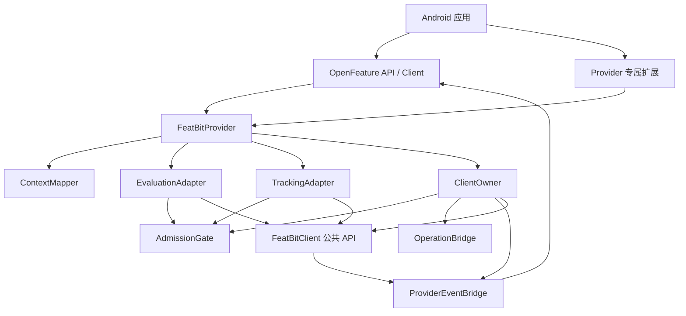
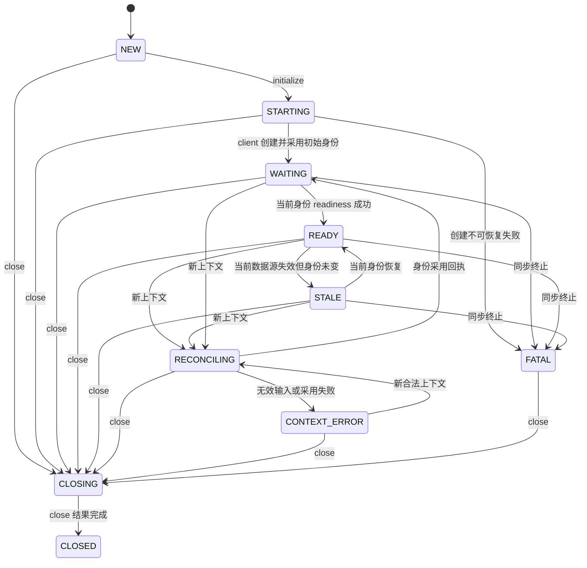
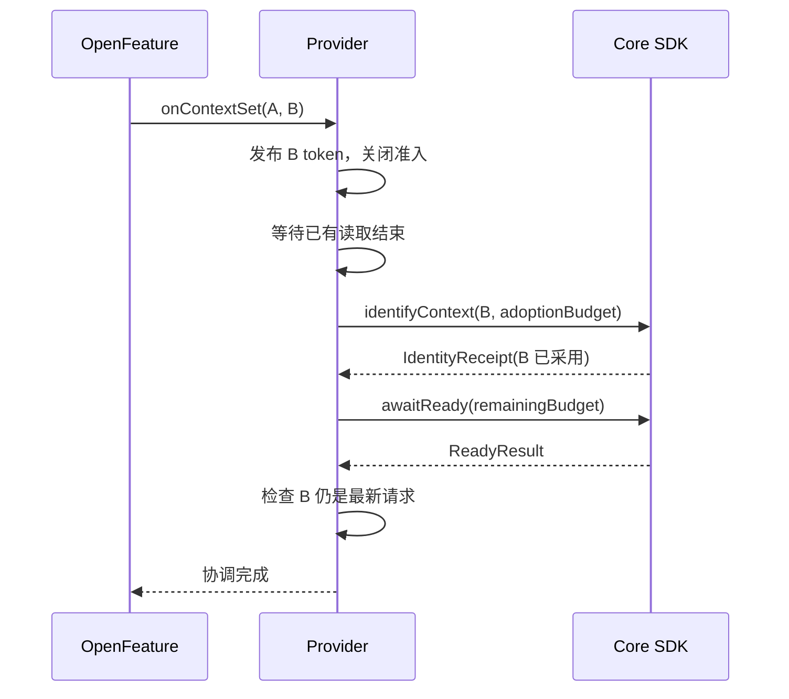

# 详细架构设计

设计日期：2026-10-05；基线更新：2026-10-06；设计补充：2026-10-09。状态：Provider 开发实现已建立，验收范围见[验证记录](./verification.md)。本文与 [核心 SDK 契约](./core-sdk-contract.md) 定义接入目标；[API](./api-design.md) 定义公共边界，[行为规范](./behavior-design.md) 定义映射规则。核心 SDK 0.2.0 已发布并满足 G01；OpenFeature 0.9.0 的状态仲裁仍未满足 G02，Provider 已执行部分验证，完整发布闸门仍未全部通过。

## 1. 架构决策

| ID | 决策 | 原因 |
| --- | --- | --- |
| D01 | 单 Android AAR，独立仓库和版本 | 核心 SDK 不依赖 OpenFeature；不扩大为多平台实现 |
| D02 | Provider 独占一个核心 client，不暴露 getClient | 身份切换只有一个写入口，避免上下文失配 |
| D03 | 配置采用 User → ClientOptions factory | 使用 factory 提交时的合法创建身份；后来的身份变更在创建后协调 |
| D04 | 核心负责声明类型检查、Double 解析和评估事件 | 类型判断与事件必须基于同一 flag 快照 |
| D05 | 身份采用与 readiness 分开完成 | 超时不代表身份未改变，匿名身份尤其需要明确回执 |
| D06 | 短状态锁 + 串行控制协程 + 同步读取租约 | 同步评估不阻塞等待网络，身份切换不能穿过评估/Track |
| D07 | 生命周期状态与数据可用性分开 | Stale 可读；Reconciling、非法上下文和 Fatal 不可读 |
| D08 | 事件是最新状态和失效通知，不是审计日志 | 慢订阅者可以合并变化，但不能丢失最终状态/失效信号 |
| D09 | OpenFeature 错误走具体异常 | 使 v0.9.0 的 error hooks 和默认值处理生效 |
| D10 | 同步 shutdown 只关闭准入，close 暴露异步完成 | 不阻塞主线程，保留实际清理与丢失统计 |

不增加网络层、缓存层、用户持久化、重试器或事件发送器。Core 已有的 TestData、后台策略和隐私处理仍为唯一实现。

## 2. 组件与依赖

| 组件 | 输入与输出契约 | 拥有资源 |
| --- | --- | --- |
| FeatBitProvider | FeatureProvider 方法与扩展方法；转发而不自行维护第二份状态 | immutable 配置、下列组件 |
| ContextMapper | EvaluationContext 快照 → CanonicalContext 或安全的 ContextFailure | 无运行时资源；纯转换 |
| ClientOwner | Initialize/ChangeContext/ChangeMode/Close 命令；完成生命周期等待者与扩展 Operation | 唯一 client、control scope、SDK 注册、创建/采用/ready 观察句柄 |
| AdmissionGate | 检查调用上下文与 RuntimeSnapshot；成功返回 ReadLease，失败返回错误 | 一个 JVM monitor、activeReaders、不可变快照引用 |
| EvaluationAdapter | ReadLease + flag key + requestedType → ProviderEvaluation 或 OpenFeatureError | 无缓存；解析委托核心 |
| TrackingAdapter | ReadLease + name/details → SDK TrackResult 或安全诊断 | 仅一次性结构忽略诊断标记 |
| OperationBridge | SDK Operation → retained result + 协程等待/外部 Operation | 单次完成槽、Registration；不假定取消观察会取消 SDK 工作 |
| ProviderEventBridge | 最新 LifecycleSnapshot、FlagChange → 每个订阅者的事件流 | 状态槽、变化序号、订阅者槽；不拥有 SDK client |
| ProviderDiagnostics | 固定 code + 可选 OutcomeCode → 配置的核心 Logger | 默认 Android 日志后端；不记录 key、上下文或凭据 |

内部接口均不作为用户可注入扩展。测试只替换内部 CoreFacade、时钟和调度器，不增加公开 clientFactory/dispatcher 参数。

## 3. 内部数据模型

| 模型 | 字段/不变量 |
| --- | --- |
| CanonicalContext | Named(key, name, immutable attributes) 或 Anonymous；使用完整内容比较，不以 hash 作为身份凭据 |
| RequestToken | 每次入口生成的新对象；引用相等表示同一请求，不依赖 Long 计数不会溢出的假设 |
| RuntimeSnapshot | phase、desiredToken/context/error、creationContext、adoptedContext、identityReceipt、readiness、connection、modeRevision、closing；creationContext 在 factory 提交时冻结，其余状态一次性整体发布 |
| Readiness | Unconfirmed / Remote / Local / Stale；与 phase、context token 联合判断，不只看 SyncStatus |
| ReadLease | client 引用、adoptedContext、requestToken、release-once 标记；不向应用暴露 |
| PendingContext | 只保留最新请求、映射快照和等待者；被覆盖请求结束为取消，不积压全部用户历史 |
| LifecycleSnapshot | revision、Ready/Stale/Error/无公开状态、errorCode、安全 message；不包含用户信息 |
| ChangeAccumulator | 精确 key 集合或 All；All 吸收后续 key，直到该订阅者消费 |

ContextMapper 在入口调用一次，复制属性，后续不得读取可变 EvaluationContext。调用者并发修改自定义 Context 的行为不受支持；异常转 InvalidContextError，不能启动 SDK。同步评估同样快照并规范化传入 context。

初始 null 与 ImmutableContext 的空 key/空 attributes 在匿名策略下等价。`getTargetingKey()` 返回非空 String，缺省为 `""`；不能使用 null/缺省与空字符串来区分两类用户意图。

## 4. 状态机

图展示主路径；任意存活态都可被终止错误转 FATAL。FATAL 不自动重建 client；重新注册必须使用新 provider。CLOSED 是准入和可观察 close 结果的终态，若结果说明清理不完整，晚到资源清理仍可继续。

| phase | 同步评估 | Track | 允许控制操作 |
| --- | --- | --- | --- |
| NEW/STARTING | PROVIDER_NOT_READY | 诊断并丢弃 | initialize、close；onContextSet 在 STARTING 可保存最新请求 |
| WAITING | PROVIDER_NOT_READY | 诊断并丢弃 | context、offline/online、flush、clearCache、close |
| RECONCILING | 新期望上下文报 NOT_READY，其他上下文 INVALID_CONTEXT | 丢弃 | 新 context 可覆盖；mode 排在当前采用命令后；flush、close |
| CONTEXT_ERROR | 保存的上下文错误优先，不读旧身份 | 丢弃 | 新 context、flush、close；clearCache 拒绝以免作用于旧用户 |
| READY/STALE | 当前上下文可读；不匹配 INVALID_CONTEXT | 当前上下文可 Track，由核心控制发送 | 所有扩展操作 |
| FATAL/CLOSING/CLOSED | PROVIDER_FATAL | 丢弃 | FATAL 仍允许 flush/close；CLOSING/CLOSED 仅查询/幂等 close |

WAITING 超时仍为 WAITING，并保存等待失败诊断；不等同 FATAL。显式 offline 采用 Local readiness，即使本地 flag 集合为空也可 READY，此后具体 key 返回 FLAG_NOT_FOUND。在线缓存只有在本身份曾被确认且转为 STALE 时可用于正常评估；冷启动缓存不提前放行。

## 5. 调度、锁与线性化点

控制协程运行在 Dispatchers.Default 的逻辑单消费者上，不创建专用常驻线程。耗时 factory 和 SDK create 的准备调用在独立工作任务执行，结果回到控制器。SDK 自己拥有磁盘/网络线程。时间使用 elapsedRealtime，deadline 加法饱和到 Long.MAX_VALUE，不能使用墙钟计算超时。

状态 monitor 仅做快照交换、租约计数及命令槽更新。禁止在其中调用 SDK、用户 factory/logger、suspend、解析 JSON、emit 或等待 Operation。SDK 回调只写完成槽/最新信号并唤醒控制器，不内联执行状态迁移。

**同步评估租约协议：**

1. Mapper 在锁外得到调用上下文；进入 gate，确认 phase、期望身份和采用身份一致且允许读取。
2. activeReaders 加一并捕获 lease，立即离锁。严格评估或 Track 在锁外执行。
3. 新上下文入口先在 gate 发布新 token 和屏障，阻止新 lease；已有 lease 可以完成。控制器等待 activeReaders=0 后才提交 SDK 身份/模式变更。
4. 读取返回前再次检查 lease token。若期间出现新请求，返回 NOT_READY/INVALID_CONTEXT，不暴露旧结果；finally 恰好释放一次 lease，最后一个释放者唤醒控制器。
5. 已有 lease 在切换请求前被接纳、且在核心提交点成功的评估可以记录旧用户事件。这是先于 SDK 身份变更的合法事件；不能因调用者后来收到 fallback 就追溯删除。承诺的是**类型/解析失败允许记录选中 variation，但事件永不归到错误用户**，不是并发取消能够撤销已发生事件。

这样无需在 provider 锁内解析大 JSON，也无需扩展核心的 Track 协议。活跃租约由实际调用线程持有，不建立无限评估任务队列。新的身份请求关门后不会被持续新评估饿死；已在执行的大输入可能延长切换等待，应算进生命周期 deadline。

| 动作 | 线性化点 |
| --- | --- |
| 新上下文取代旧请求 | gate 发布 desiredToken 并关闭新 lease |
| SDK 用户真正改变 | 核心 adopt 与 IdentityReceipt 结算的同一 gate |
| 评估值/曝光归属 | 核心确认快照仍有效并准入事件的 gate |
| Track 用户归属 | 核心 events.track 的 gate；提交前后都不能穿插 provider identify |
| 关闭准入 | provider gate 标记 closing；不等于释放完成 |
| 关闭完成 | retained close Operation 第一次 settle |

close 是特殊控制命令：立即关门，可直接通知核心 close，不等待活跃解析租约。核心已关闭后不得准入新事件；provider 的返回前检查拒绝晚到成功结果。正常后台网络更新不需要租约，核心自己的快照仲裁负责同步竞争。

## 6. 初始化协议

1. NEW → STARTING；并发重复 initialize 加入同一初始化任务，不重复调用 factory/create。同一 provider 再次注册且已创建时只协调传入上下文；终态不重新创建。
2. 在 factory 尚未调用时采用最新合法上下文；一旦提交 factory 调用，冻结 creationContext，factory 对该身份仅调用一次。PERSISTENT_ANONYMOUS 策略始终要求 anonymousEnabled=true，即使首次是具名用户，保证后续退出登录可用。
3. 校验配置与冻结的 creationContext 一致；create 提交前检查 close，但不因新的上下文重复调用 factory。无论新上下文到来时 factory 正在运行、已返回但 create 尚未提交，还是 create 已提交，都保留这次创建流程。取得 client 后先协调最新有效且未过期的上下文，绝不按旧上下文打开准入。关闭已经发生则禁止尚未提交的 create。
4. 创建成功后立即登记 owned client。安装一条 status 和一条 changes 注册；任一失败，撤销已成功注册，关闭 client，初始化以 GENERAL 失败并进入 FATAL。
5. 初始身份由 create 成功证明已采用；保存冻结的 creationContext，而不是此时的 desiredContext。建立当前 SDK getConnectionInformation 快照，再调用 awaitReady。网络恢复继续由核心运行。
6. 完成最新上下文的采用与 readiness 后，检查其 token 仍有效，再设置内部 READY 并完成相应生命周期等待者。创建结果由 ClientOwner 持有，即使创建身份的 token 已旧也必须登记和协调；旧身份的 ready 结果不能解锁新身份。

初始化期间 A→B 的例子：factory 已为 A 启动时 B 到来，仍只创建一次 A，再调用 identifyContext(B)。核心可能先启动 A 的同步及自身用户事件；provider 在 B 采用且就绪前不放行评估或 Track。这是首版明确接受的创建边界，不承诺消除已冻结创建身份的所有网络活动。若最新 B 非法或其切换请求在提交采用前过期，保留其失败状态，不按 A 放行；后续合法请求可以恢复。

初始化 timeout 从入口开始，包括 factory、create、切换排空和 ready 等待。调用方等待超时不销毁已接受的初始化；owner 持有 create 结果，未 close 时可继续完成并发 Ready。取消仅移除该等待者；生命周期取消异常必须原样传播。

Factory 抛错、返回无效配置或创建失败：仅完成一次失败，不自动重复调用用户 factory。初始上下文在 factory 之前即非法时保持可纠正的 CONTEXT_ERROR；后续合法上下文可以启动尚未调用的 factory。已经消耗 factory/create 且失败则 FATAL，需要新实例。

## 7. 上下文切换协议

oldContext 仅作为调试线索，不作为内部真实状态。若规范化新上下文等于已采用且 READY/STALE 的身份，不再次 identify；READY 可立即完成，STALE 使用当前核心 readiness/状态决定结果，不强行把 Stale 改为 Ready。同身份 WAITING 仅重新等待；采用失败且未生效则必须重新提交采用。

RequestToken 在入口先取得顺序，映射在锁外完成；映射完成后若 token 已旧，则不覆盖较新的期望上下文。新输入即使无效，也必须先关掉旧身份准入。超过等待者容量的请求则在接受前拒绝，不改变当前 token。

在采用 B 的异步匿名准备过程中到来 C：关闭准入并替换待处理请求。控制器可提交最新 C 的身份命令，使核心 identity 请求序号取代 B；不等待 B 的远端 ready。B 的回调必须按 token 丢弃，核心保证被取代的准备不 adopt。若 C 非法，则不发 C 的 SDK 命令，B 可能完成内部采用，但 provider 仍维持 CONTEXT_ERROR 并拒绝评估；不能让 B READY 清除 C 错误。

采用 Operation 的 owner 观察与用户等待者独立。用户超时后 owner 仍接收已完成回执；只有收到回执才能把目标身份设为 adopted。匿名准备最终 TIMED_OUT/STORAGE_FAILED 时禁止拿旧身份 awaitReady 冒充成功，保留 CONTEXT_ERROR，用户再次提交同一上下文可重试。

普通上下文请求的整体 deadline 从入口计算。采用尚未提交就到期时，不在稍后悄悄提交，保持目标上下文失败并等待显式重试；已提交采用使用当时剩余预算，core 只保证其内部采用 deadline。已采用后的 readiness 等待到期不取消同步。初始化任务本身独立于调用者等待：create 晚到仍可完成初始身份，但若新的上下文请求已失败/过期，不能按初始身份放行该新上下文。

调用顺序以 provider 入口接受顺序为准。应用应串行使用 setEvaluationContextAndWait，或使用上游的 setEvaluationContext 替换旧请求；不承诺多个并发 AndWait 调用按业务墙钟顺序完成。即使上游保存的上下文与实际最后回调不一致，provider 的上下文门禁仍拒绝错误身份评估。

## 8. Readiness 监控和模式变化

控制器最多持有一个当前 awaitReady 观察，旧 readiness 回调带 token/modeRevision 后作废。状态回调内容只是唤醒提示：每次处理重新读取 getConnectionInformation，不使用排队 READY 直接完成协调。

Readiness 等待到期但身份已采用后，保留 status 订阅。收到当前快照的 READY/恢复/模式变化提示时，发起一次短 awaitReady 确认（使用 contextChangeTimeoutMillis），即使没有新状态回调，该确认结果也能完成恢复。每个状态变化周期最多一个确认；确认超时后等下个提示或显式相同上下文重试，不建立定时无限重试任务。

确认成功后必须重新读取连接快照：TERMINAL/CLOSED 优先终止；在线 STALE 且本身份已有确认则进入 STALE、发 Stale，不能仅凭 REMOTE_CONFIRMED 把连接标成 READY。显式 offline 的 OFFLINE_LOCAL 与 LOCAL source 的 CUSTOM_LOCAL 按本地策略就绪。在线 STALE 但从未得到本身份确认仍保持 WAITING。相同已采用的 STALE 上下文可以正常结束协调，但保留 Stale 事件和状态，依赖下节的上游生命周期提交仲裁。

setOffline/setOnline：先校验 timeout 和调用状态，接受后关闭新 lease、排空读取，与身份命令按控制器提交顺序执行。使用独立的 mode 命令标识和 modeRevision；改变 mode 不改变 CanonicalContext。模式操作结果与恢复读取分别结算：

- SUCCESS、INVALID、TIMED_OUT、CAPACITY_EXCEEDED 等结果均不能直接决定实际模式。操作完成后，owner 在锁外读取 isOffline 与 getConnectionInformation，并仅在当前身份 token、modeRevision 仍有效时更新状态；若此时已有更新命令，则由更新命令负责恢复。
- 失败且实际模式未变：重新确认当前身份的 readiness，恢复其 READY/STALE 或保持 WAITING。离线启动缺少在线端点时 setOnline 失败，应保留离线本地可读能力，不能永久关闭准入。
- 操作超时但实际已离线：按 OFFLINE_LOCAL 恢复当前合法身份的读取，原操作仍报告 TIMED_OUT；不自动回滚或重试。核心可能已经采用离线模式，只是等待旧连接停止时超时。
- 真正从离线变在线时，核心清除旧确认，provider 进入 WAITING 并等待新确认；重复 setOnline 不视为新的模式转换，不主动清空仍有效的 readiness。
- 实际离线可得到 OFFLINE_LOCAL；TERMINAL/CLOSED、CONTEXT_ERROR、关闭及更新上下文屏障优先，模式恢复不能越过它们。确认仍未就绪则按本节订阅协议继续恢复。

ModeResult 仅描述该命令的结果，不保证返回时尚无后续模式命令，也不表示远端数据就绪。扩展操作的失败不直接把整个 provider 改成 Error/Fatal；只有实际生命周期状态满足条件时才发布对应事件。

clearCache(CURRENT_CONTEXT) 只在已稳定采用的身份上提交，排在已接受的身份变更后；在 RECONCILING/CONTEXT_ERROR 拒绝为 INVALID + provider_context_unavailable，不能偷偷清除前一个用户缓存。NAMESPACE 同样采用这一规则以保持扩展 API 简单。flush 覆盖核心已接受事件，允许 WAITING/RECONCILING，不改变身份。

### 扩展操作的排队与超时

setOffline、setOnline、clearCache 的 timeoutMillis 从 provider 入口接受调用时开始，包含排队、租约排空、提交和等待结果。正数校验在建立屏障之前完成；使用 elapsedRealtime 与饱和 deadline。提交前再次检查关闭、命令适用的身份/模式条件与剩余预算，仅把剩余毫秒传给核心。

- 提交前预算耗尽：结算 TIMED_OUT，移除命令，绝不晚到提交；如该命令建立了读取屏障，按当前 token/实际状态撤销其屏障，不影响更新请求。
- 提交后预算耗尽：先查询核心保留结果，再通过单次结算仲裁决定返回核心结果或 TIMED_OUT；外部结果结算后不再改写。owner 保留已提交操作的观察，接收晚到结果并恢复状态。
- 外部超时或取消观察不撤销核心工作；模式可能已变，已提交的清缓存也可能随后完成。不得把超时描述成无副作用，不自动重试有副作用的操作。
- 模式恢复使用独立的 readiness 确认预算，不延长原操作的结果预算；尚未确认可读时保持关闭准入。

clearCache 提交时再次确认稳定身份，并以提交时的核心身份为作用对象；若排队期间身份已不稳定，则拒绝本次提交。flush 没有公开 timeout 参数：provider 从接受时使用 ClientOptions.requestTimeoutMillis 约束对外等待，包含排队；提交后核心仍使用自己的发送预算，外部超时不取消发送或声称覆盖后来接受的事件。close 不排在普通命令之后，预算从 close 入口开始，沿用第 11 节规则。

## 9. 事件桥与容量

直接使用 subscribeChanges/subscribeStatus，不用核心 ClientAdapters.changes：该 Flow 会把全局变化统一转换成全量失效，无法保留精确 keys。

采用一个共享生产端和**每订阅者一个可合并槽**，不直接把所有事件放进 replay=1 的 SharedFlow。每槽含最新 LifecycleSnapshot、ChangeAccumulator 和一个 conflated 唤醒信号；因此配置事件不会挤掉唯一 Ready/Stale/Error。

| 资源 | 决策 |
| --- | --- |
| SDK 注册 | 每 provider 固定 2 条，不随 observe 订阅增加 |
| observe 活跃订阅者 | 不设固定数量上限；应用与 OpenFeature 内部监听使用相同接口，不能因应用先订阅而拒绝内部监听 |
| 每槽精确变更 keys | 最多 1,024；超出升级为 All，属于通知缓冲保护，不限制实际 flag 数量 |
| 生命周期状态 | 每槽仅最新一项；短暂中间状态可合并，不承诺事件逐条审计 |
| 控制命令 | 一个最新 context 槽、一个状态信号槽；扩展操作最多 64 个待派发，超限 CAPACITY_EXCEEDED |
| 生命周期等待者 | 每 provider 最多 64；额外调用 GENERAL/capacity，不覆盖已有有效请求 |
| SDK Operation 观察失败 | 检查 getResult；未完成时 owner 保留引用，合并到单个 50ms 结果探测任务；正常 observe 成功路径不轮询 |

每个订阅者仍只有有界的状态/变更槽；总内存随活跃订阅数量增长，不声称全局固定上界。collect 取消或正常结束时在 finally 解除注册并释放槽；关闭时结束所有槽。慢订阅者不阻塞其他订阅者，也不额外安装核心监听。

每个 SDK 回调先在桥的短锁内合并槽，随后唤醒，绝不调用订阅者。collector 取走状态和失效快照后锁外 emit，挂起期间的新变化留在槽中。下一轮再次比较状态 revision。新 collector 在同一锁中注册并快照：先收到当前可公开状态，再收到 All 失效（若已创建数据源），确保迟到订阅者重新读取。

正常初始化和协调进入 READY 时也发布一次 ProviderReady，理由是 v0.9.0 生命周期成功只更新 statusFlow，不会自动向 observe 返回的 provider 事件流产生 Ready。若最终状态是 STALE，则发布/保留 Stale 而非 Ready。状态更新与这个事件可能表达同一次成功，按 token/revision 去重，不重复产生多条 provider Ready。此决定修正初稿“完全由上游发 Ready 事件”的假设。

身份切换开始时使旧 lifecycle 快照不可重放，清空精确 keys，积累 All。READY 前延后变更事件；READY 后先发状态，再发失效。CONTEXT_ERROR/FATAL 发安全 Error；普通等待超时发 PROVIDER_NOT_READY；关闭时使所有槽完成，清掉未发送配置事件。流收集取消只解除该槽，不关闭 provider。

## 10. OpenFeature v0.9.0 的状态交接限制

2026-10-06 重新核对：正式版仍为 0.9.0，其 OpenFeatureAPIInstance 与 main `8d727fbead4b8d8bc66dc271ad35de1ece603a8b` 的实现相同。setProviderInternal 在 initialize 返回后无条件写 Ready。若 provider 在此窗口已发 Stale/Error，该 Ready 可以覆盖更新状态。该时序现已由确定性复现测试确认，本项目已通过确定性测试复现该问题，见[验证记录](./verification.md)。接口没有“SDK 已提交初始化状态”的回调；provider 无法靠 yield、固定延时或重新读取自己的状态证明避开此窗口。

因此区分两项保证：provider 自身的准入、身份、返回值和事件桥由本文协议保证；**OpenFeature.getStatus 的最终一致性还依赖上游初始化提交修正**。不在 provider 中轮询全局 OpenFeatureAPI，也不反射改私有状态；隔离 API 实例必须同样可用。

推荐上游修正契约：注册初始化捕获 provider 引用/绑定 generation 和 providerStatusGeneration；成功或失败提交时在同一状态仲裁锁内校验绑定仍有效，并且初始化期间没有更新 provider 事件；已有更新事件时不覆写其状态。换 provider、取消初始化及旧初始化异常也应用这一规则。阶段验收 G02 必须通过；未修正的 0.9.0 可以作为复现基线，不能声称满足本设计完整状态保证。最终最低依赖版本在包含该修正的制品验证后锁定。

上下文协调也采用同一原则：在调用 onContextSet **之前**捕获事件 revision/请求序号；结束时若已有更新的 provider 状态或更晚请求，则不覆写。当前源码在完成协调时才保存事件 generation，不足以保护方法内部先发 Stale、随后正常返回的情形。成功协调的默认 Ready 仅在无更新事件时提交；已保留的 Stale/Fatal 或旧请求之后的新状态优先。同步短路和实例替换也必须检查当前绑定。

## 11. Operation、错误和清理

OperationBridge 必须先 getResult，再 observe，再次 getResult，使用单次完成仲裁防止完成/注册竞态。owner 注册在结果完成或工作被关闭且已交接清理后撤销；用户的 await 取消只撤销用户等待，不释放 owner 的结果接收责任。回调异常隔离并诊断。

Provider 自己返回的 Operation 实现与核心相同的 retained result/observe 语义，回调异步执行、可解除、恰好一次，不引入 Future 或第二套公开错误类型。取消观察不取消已接受的 mode/flush/cache/close；未提交命令仍受第 8 节 deadline 约束，超时后不得提交。

| Outcome | 生命周期处理 |
| --- | --- |
| SUCCESS | 必须同时通过当前 token/模式与状态校验 |
| INVALID | 用户映射类为 INVALID_CONTEXT；配置/调用契约类 GENERAL |
| SUPERSEDED | 本请求已被替代时传播 CancellationException，不制造旧 ProviderError |
| TIMED_OUT | 等待 not-ready；采用失败与已采用等待超时按阶段区分 |
| TERMINAL_FAILURE/CLOSED | 存活实例进入 FATAL；自己关闭时不发额外错误事件 |
| DEFERRED | mode 变化后重新判断；后台/暂停时保留等待，不伪装成功 |
| DISABLED/STORAGE_FAILED/CAPACITY_EXCEEDED/CLEANUP_FAILED | 安全 GENERAL，结合当前阶段决定是否可显式重试；扩展 API 保留原 Outcome |

关闭时 gate 关门，所有未提交普通命令失败为 CLOSED，等待者解除，撤销两条 SDK 订阅并结束 observe，owned client 只 close 一次。保留 create/身份采用等晚到结果的 owner 回收路径。

Provider close 的对外等待预算取已生成 ClientOptions.closeTimeoutMillis；factory 尚未完成时使用 5,000ms。它是“何时结算 close 结果”的预算，不是杀死第三方 factory 的承诺。没有创建任务时 close 成功且 undeliveredEvents=0；有未完成创建且截止时仍未知，则返回 TIMED_OUT + provider_cleanup_pending，不能捏造 CloseResult。已有 client 的核心 CloseResult 原样传播；晚到创建结果仍立即 close，但不重写已结算结果。

控制 scope 仅在无残留 owner 任务后释放；不合作的用户 factory 可能保持后台清理责任，必须明确报清理未完成。不得清空用户缓存或匿名身份文件作为 close 的副作用。

## 12. 打包与可观测性

建议单一 provider 模块，包根 co.featbit.openfeature.android；internal 下按 context、runtime、evaluation、events、diagnostics 分目录。测试 fixture 位于测试源码，消费者另建 Kotlin/Java 根工程。只发布 release AAR、sources、API 文档和 Maven 元数据。

公开 API 中出现核心 Outcome/Operation 和 OpenFeature 类型，两项依赖均采用 api。基线 Kotlin 2.2.10、JVM 11、minSdk 21；Provider 的最低 Kotlin 消费者版本独立验证，不能沿用核心的 1.9 消费者承诺。AGP/Gradle/JDK 在实现时从可构建组合固定，不因本文提案自动升级相邻核心项目。

诊断仅使用固定 code，如 provider_context_unavailable、provider_options_user_mismatch、provider_track_structure_ignored、provider_cleanup_pending；默认 WARN。相同的“结构未发送”每实例只记录一次，其余按状态变化输出。调用用户 Logger 在状态锁外，异常不得改变 provider 状态。隐私不依赖应用 hook 是否安装。

详尽验收时序见 [并发与集成验收](./architecture-validation.md)。
